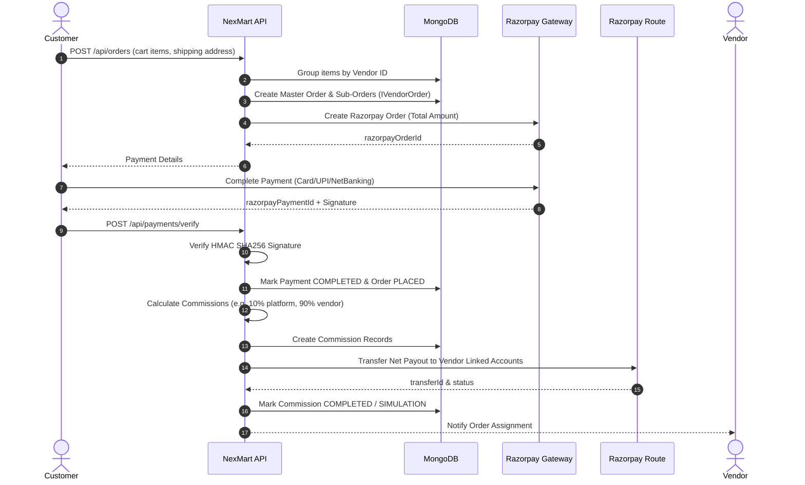

# FS-01 System Architecture Document
# Organization: Nexvia Technologies Private Limited
# Project: NexMart — Multi-Vendor E-Commerce Marketplace

## 1. System Overview

NexMart is an Amazon-style multi-vendor e-commerce platform built with an enterprise-grade full-stack architecture. The application enables multi-vendor order fulfillment, automated commission calculation via Razorpay Route transfers, Elasticsearch product catalog indexing, Redis query caching, S3 asset storage, and role-based access control (Admin, Vendor, Customer).

```mermaid
flowchart TD
    Client["React 18 + TypeScript Client\n(Port 3000)"]
    API["Express.js + TypeScript Backend\n(Port 5000)"]
    DB[(MongoDB\nCollections & Aggregations)]
    Cache[(Redis Cache\nTTL 1 hour)]
    Search[(Elasticsearch\nFull-Text Search)]
    Storage["AWS S3 / Local Dev Storage\n(Product Media & Invoices)"]
    Gateway["Razorpay Payments & Route\n(Multi-Vendor Linked Transfers)"]

    Client -->|Axios REST / JWT| API
    API -->|Mongoose ODM| DB
    API -->|ioredis| Cache
    API -->|@elastic/elasticsearch| Search
    API -->|@aws-sdk/client-s3| Storage
    API -->|Razorpay Node SDK| Gateway
```

---

## 2. Multi-Vendor Order & Commission Split Architecture

When a customer checks out with products originating from multiple vendors in a single cart, the backend decomposes the master order into separate Vendor Orders.



---

## 3. Storage & Search Fallback Architecture

- **Elasticsearch**: Syncs on product creation and updates. Automatically falls back to MongoDB regex queries if Elasticsearch cluster is offline or unreachable.
- **Redis Cache**: Caches hot categories and featured products. Gracefully degrades to database reads if Redis is disabled or unavailable.
- **Media Storage**: Employs AWS S3 presigned URLs in cloud environments and a local static file server (`/uploads`) for local development without credentials.
- **Payment Gateway**: Supports Razorpay Test Mode and an automatic simulated payment mode for headless test runs.

