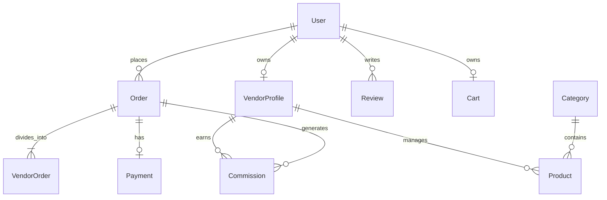

# FS-01 Database Schema Documentation
# NexMart — Multi-Vendor E-Commerce Marketplace
# Database: MongoDB (Mongoose ODM)

## Entity Relationship Overview

---

## Collections & Schemas

### 1. `users`
Represents platform customers, vendors, and platform administrators.
- `_id`: ObjectId (Primary key)
- `name`: String (Required, trimmed)
- `email`: String (Required, unique index, lowercase)
- `password`: String (Bcrypt hashed, select: false by default)
- `role`: Enum `['CUSTOMER', 'VENDOR', 'ADMIN']`
- `phone`: String (Optional)
- `avatar`: String (URL)
- `isActive`: Boolean (Default: true)
- `addresses`: Array of Subdocuments:
  - `fullName`, `phone`, `street`, `city`, `state`, `postalCode`, `country`, `isDefault`
- `timestamps`: `createdAt`, `updatedAt`

### 2. `vendor_profiles`
Maintains verified business records and onboarding state.
- `_id`: ObjectId
- `user`: ObjectId (Ref: `User`, unique)
- `businessName`: String (Required)
- `businessDescription`: String
- `businessEmail`: String (Required)
- `businessPhone`: String (Required)
- `businessAddress`: String (Required)
- `gstNumber`: String (Optional)
- `onboardingStatus`: Enum `['PENDING', 'APPROVED', 'REJECTED', 'SUSPENDED']`
- `adminNotes`: String (Optional feedback)
- `razorpayLinkedAccountId`: String (Razorpay Route account ID: `acc_xxx`)
- `approvedAt`: Date
- `rejectedAt`: Date
- `timestamps`: `createdAt`, `updatedAt`

### 3. `categories`
Hierarchical product taxonomy.
- `_id`: ObjectId
- `name`: String (Required)
- `slug`: String (Required, unique index)
- `description`: String
- `image`: String (URL)
- `isActive`: Boolean (Default: true)
- `productCount`: Number (Indexed cache)

### 4. `products`
Catalog items sold by vendors.
- `_id`: ObjectId
- `vendor`: ObjectId (Ref: `VendorProfile`, index)
- `category`: ObjectId (Ref: `Category`, index)
- `name`: String (Required)
- `slug`: String (Required, unique index)
- `description`: String (Required)
- `price`: Number (Required, index)
- `comparePrice`: Number (Optional MRP)
- `images`: Array of Strings (S3 / Local URLs)
- `stock`: Number (Default: 0)
- `soldCount`: Number (Default: 0)
- `avgRating`: Number (Default: 0, index)
- `ratingCount`: Number (Default: 0)
- `status`: Enum `['DRAFT', 'ACTIVE', 'INACTIVE']` (index)
- `isDeleted`: Boolean (Soft delete flag, default: false)
- `searchKeywords`: Array of Strings

### 5. `carts`
Persistent user shopping carts.
- `_id`: ObjectId
- `customer`: ObjectId (Ref: `User`, unique index)
- `items`: Array of Subdocuments:
  - `product`: ObjectId (Ref: `Product`)
  - `vendor`: ObjectId (Ref: `VendorProfile`)
  - `quantity`: Number (Min: 1)
  - `priceAtAdd`: Number

### 6. `orders`
Master customer orders supporting multi-vendor split fulfillment.
- `_id`: ObjectId
- `orderNumber`: String (Format: `ORD-YYYYMMDD-XXXXX`, unique index)
- `customer`: ObjectId (Ref: `User`, index)
- `shippingAddress`: IAddress subdocument
- `subtotal`: Number
- `discount`: Number
- `shippingCharge`: Number
- `total`: Number
- `coupon`: ObjectId (Ref: `Coupon`, optional)
- `status`: Enum `['PLACED', 'PACKED', 'SHIPPED', 'DELIVERED', 'CANCELLED']`
- `statusHistory`: Array of `{ status, changedAt, changedBy, comment }`
- `vendorOrders`: Array of Sub-orders:
  - `vendor`: ObjectId (Ref: `VendorProfile`)
  - `items`: Array of `{ product, name, price, quantity, subtotal, image }`
  - `subtotal`: Number
  - `status`: OrderStatus
  - `trackingNumber`: String
  - `trackingUrl`: String
  - `statusHistory`: Array of IStatusHistory

### 7. `payments`
Gateway transaction records.
- `_id`: ObjectId
- `order`: ObjectId (Ref: `Order`, index)
- `razorpayOrderId`: String (index)
- `razorpayPaymentId`: String (unique sparse index)
- `razorpaySignature`: String
- `amount`: Number (INR)
- `currency`: String (Default: `INR`)
- `status`: Enum `['PENDING', 'COMPLETED', 'FAILED', 'REFUNDED']`
- `method`: String
- `paidAt`: Date

### 8. `commissions`
Platform revenue cut and vendor settlement records.
- `_id`: ObjectId
- `order`: ObjectId (Ref: `Order`, index)
- `vendorOrder`: ObjectId
- `vendor`: ObjectId (Ref: `VendorProfile`, index)
- `grossAmount`: Number
- `commissionRate`: Number (e.g. 10%)
- `commissionAmount`: Number (Gross × Rate)
- `vendorNetAmount`: Number (Gross - Commission)
- `transferStatus`: Enum `['PENDING', 'PROCESSING', 'COMPLETED', 'FAILED', 'SIMULATION']`
- `transferId`: String (Razorpay Route transfer ID `trf_xxx`)

### 9. `coupons`
Promotional codes and discounts.
- `_id`: ObjectId
- `code`: String (Uppercase, unique index)
- `discountType`: Enum `['PERCENTAGE', 'FIXED']`
- `discountValue`: Number
- `minOrderAmount`: Number
- `maxDiscount`: Number
- `validFrom`: Date
- `validUntil`: Date
- `usageLimit`: Number
- `usedCount`: Number
- `isActive`: Boolean

### 10. `reviews`
Verified product feedback.
- `_id`: ObjectId
- `product`: ObjectId (Ref: `Product`, compound index with customer)
- `customer`: ObjectId (Ref: `User`)
- `rating`: Number (1 to 5)
- `comment`: String

